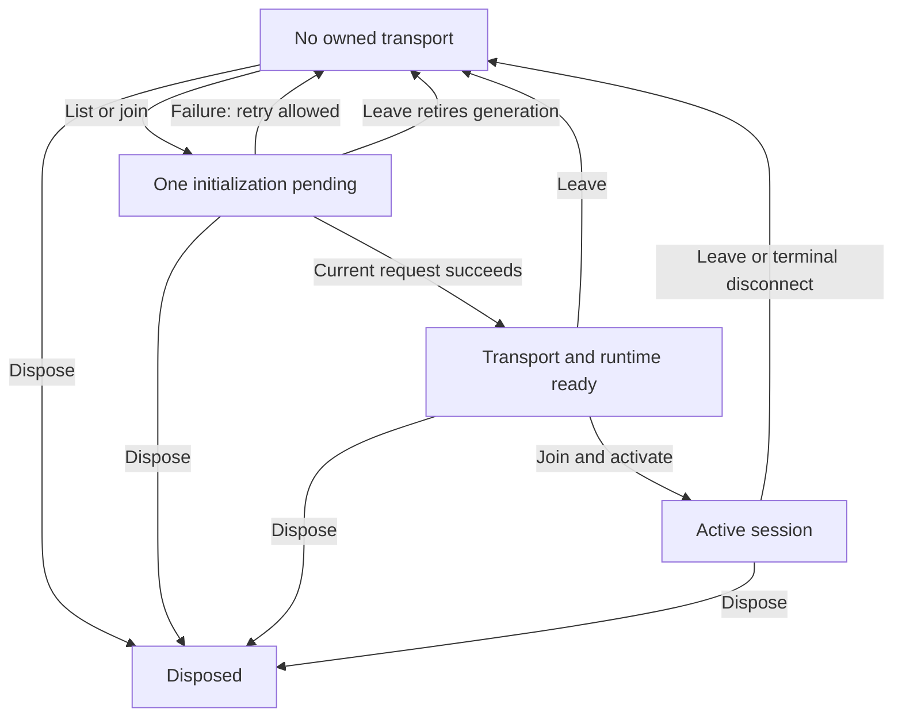

# Peterborough Map Game state-machine audit — v1.6.202

Reviewed 2026-11-10 against baseline `094b465931dd7174b8cf75621b28637e3f33f7c0` (v1.6.201).

The recommended decision is **keep small domain-owned controllers, make asynchronous ownership explicit, and test transitions before refactoring**. This release fixes demonstrated ownership defects and records the rest. A global state-machine framework would introduce migration risk across unrelated game, iframe, editor, account and server lifecycles.

There are **152 reviewed workflow groups: 83 implicit, 59 mixed and 10 explicit**, anchored in **119 first-party source files**. Implicit does not mean defective. Repeated instances (tiles, vehicles, conversations) share a group; continuous coordinates/physics and pure geometry algorithms are not separate machines. The six Tunnel Break groups belong to a separate published route with no current main-launcher link found. Configured publisher/statistics paths and historical compatibility entries are identified separately below.

This is a source-backed inventory of the inspected application, **not a proof that every possible state or transition has been enumerated**. Vendored engines/SDK internals, generated datasets, build-time geometry tools and unreachable historical implementations are outside the runtime inventory. Reachability was checked through active HTML, imports, script injection and compatibility forwarders; a dated filename alone was never treated as dead code.

## What changed and why

| Reproduced baseline defect | Change | UX / DX / agent benefit | Regression evidence |
| --- | --- | --- | --- |
| Lobby listing and immediate Create initialize two runtimes; a late completion replaces the joined runtime. Leave/dispose also allow retired work to commit. | One shared initialization promise, generation checks after awaited work, disposal on construction failure, and retry after failure. | Players retain the connected runtime; maintainers and agents have one documented owner and deterministic cancellation tests. | `tests/multiplayer-initialization.test.mjs` |
| An old token refresh rejects after a newer account succeeds and clears the newer account/subscriptions. | Both success and failure cleanup belong to the refresh generation. | Account UI and drafts no longer disappear from an unrelated stale failure; the existing access rules remain authoritative. | `tests/feedback-account-lifecycle.test.mjs` |
| Saving private note A clears newly typed draft B when A finishes. A retired error can show in a reopened thread. | Capture the textarea, submitted body and submission ID; clear only that exact draft in the owning conversation. | New text survives; retries retain the original idempotency identity; asynchronous outcomes have an explicit owner. | `tests/feedback-workflow.test.mjs` |
| A failed developer status edit restores the thread snapshot captured when it opened, even after a newer subscribed status arrives. | Restore from the latest selected thread, and ignore retired conversation errors. | Displayed state agrees with current subscribed data. | `tests/feedback-workflow.test.mjs` |
| An Earlier messages request or reply rejects after navigation, displaying the old error in a different or reopened conversation. | Apply the existing account/conversation/generation guard to failure as well as success. | Current errors remain visible; retired requests cannot overwrite the new view. | `tests/feedback-workflow.test.mjs` |
| `pagehide` stops the driving HUD interval permanently; cached `pageshow` leaves stale speed/details. | Idempotent start/stop; restoration refreshes immediately and starts exactly one loop. | Returning to a cached page restores a live HUD; its lifecycle has a direct regression. | `tests/driving-ui-lifecycle.test.cjs` |

Release normalization now versions the feedback service alongside the UI, so a newly loaded interface cannot reuse the old dated auth-service import. Existing gameplay/scoring, geometry, multiplayer protocol and persisted-data formats were retained. The multiplayer world export remains `6a591732d8f63f37a15c7a93` with road build `4ac89570c75e0922fd6e`.

## How to use the map

The [JSON companion](state-machines.json) has a stable ID for each workflow, conceptual states, events, authoritative variables, invariants, exact source anchors, existing inspection APIs, related tests and follow-up notes. The table below provides a readable index. These are documentation models, not an additional executable state authority. An empty inspection/test list explicitly means that no established API/test was identified for that boundary. Test references are related coverage, not a claim that every transition has been exercised.

Run `node tools/check-state-inventory.mjs` to validate IDs, source anchors and test paths. This check runs in the Pages workflow. It detects broken references; semantic drift still requires code review. Line hints reflect this release; anchors are the durable locator. [Repository agent instructions](../../AGENTS.md) explain how future changes should maintain these contracts.

For runtime inspection, start with existing APIs rather than scraping UI labels:

| Area | Existing inspection surface | Important limit |
| --- | --- | --- |
| Startup / 3D loading | `__PTBO_EXPLORER_BOOTSTRAP__`, `__PTBO_CITY_LOADING__.state()` | Loading progress is separate from playable-region readiness. |
| 3D gameplay / map | `__PTBO_GAMEPLAY__`, `__PTBO_MAP_VIEW__.state()` | Actor mode, map presentation and input ownership are parallel concerns. |
| Multiplayer | `__PTBO_MULTIPLAYER__`, runtime `getState()`, transport `getSession()` | Do not log internal player/reconnect/admin credentials; `active` is not a full connection lifecycle. |
| Response startup | `PTBO_ENHANCEMENT_STAGE`, `PTBO_BUILD_ERRORS`, startup trace | Per-document identity matters when an iframe reloads. |
| Editor | existing editor state, draft/base identity, command history, AI revision guard | Saved commit, deployment in progress and verified live are distinct states. |
| Feedback | service account, thread snapshots and submission IDs | Account epoch and conversation/draft generation govern all late completions. |

## Transition contracts to preserve

- **One owner per asynchronous operation.** Check identity after each await, on errors as well as successes. Clearing an old promise must not clear a replacement operation.
- **Cancellation is an outcome.** Leave/dispose/close retire the work they own. A resolved old request must not resurrect a session or a deleted UI.
- **Derived UI follows authoritative data.** Buttons, status text and datasets are projections, not alternative sources of truth.
- **Independent concerns remain independent.** Do not collapse map view, driving/on-foot mode, aerial control, room membership and modal focus into one enormous enum.
- **Retries preserve identity where needed.** Reusing a submission ID prevents duplicates; newly edited text owns a new ID.
- **Cached documents resume resources.** A timer/observer that stops on pagehide needs an intentional restore policy. Repeated restore events must not duplicate resources.
- **Saved is not live.** A saved version/commit and a confirmed deployment need separate outcomes and language.

The multiplayer initialization model below is conceptual; it does not introduce a second public enum:

## Remaining work, ranked by evidence

| Next candidate | Evidence and decision |
| --- | --- |
| Response tablet keyboard and focus ownership | JSDOM reproduces ArrowRight being cancelled before the map, missing Tab containment and focus left in the hidden overlay after close. Address as a separate input/focus change with real-browser tests; preserve the existing driving freeze. |
| Geo wrapper absent-app recovery | Source shows no local timeout if the app never creates its readiness promise. This failure path needs fault-injection/browser reproduction before a recovery change. |
| Other feedback global-error and recovery callbacks | Source review found view-ownership gaps in thread pagination, export, sign-out and recovery retry. Their user-visible effects were not reproduced in this release; the JSON records each remaining boundary. |
| Other pagehide-only observers/history drains | Source inspection identifies stopped resources without reviewed restore handling. Only the driving-HUD case was reproduced and fixed here. Add focused restore tests before touching unrelated observers. |
| Service chooser/dispatch iframe and basemap switch ownership | Some stale-document or post-fade guards are missing in source. User-visible impact remains a hypothesis, not a verified production incident. |
| Large 3D mode/input cross-product | High coupling, but no new reproduced failure here. Preserve existing tested guards; introduce a read-only consolidated snapshot only when a concrete consumer needs it. |
| Configured publisher and statistics requests | Distinguish saved-then-deployment-failed messaging and stale refresh ownership when those backends are enabled. Current checkout does not establish that those optional configurations are live. |

Each narrower note is retained in the JSON `followUp` field and below. This release does not silently declare those concerns fixed.

## Verification

- Baseline: 1,564 Node tests passed after installing the repository's development dependencies.
- Final suite and review results are recorded in [the verification record](state-machines-verification.md).
- The new regressions were run against the baseline behavior and failed for the identified ownership/lifecycle defects before the fixes.
- Independent subsystem source audits and a fresh whole-change code review were used. Tests and source review do not establish zero regression risk on every device/network.
- Local Chromium could not launch because its required socket operation was denied. The separate cloud browser could not connect to the local preview (`ERR_CONNECTION_REFUSED`). DOM and real local multiplayer-server tests were performed; full browser/visual/mobile playthrough and production publication are not claimed by this audit.

## Complete workflow index

States in the table are conceptual labels, including parallel concerns; their ordering is not an exhaustive transition table. Open the JSON entry for events, invariants, all source anchors and related tests.
### 3d-editor (16)

| ID / workflow | Representation | Reviewed states | State owner | Source |
| --- | --- | --- | --- | --- |
| `editor-ai-commands` — AI command availability and revision ownership | explicit | inactive; busy; available; validated; committed; rejected stale revision; rejected input | revision; lastDocument; adapter.isActive; adapter.isBlocked; documentHistory.current | [city-explorer/editor/ai-editor-tools.js](../../city-explorer/editor/ai-editor-tools.js#L34) |
| `editor-asset-placement` — Asset placement gesture | implicit | idle; armed; previewing; committed; cancelled | pendingAssetKey; preview; documentHistory.current | [city-explorer/editor/city-editor.js](../../city-explorer/editor/city-editor.js#L315) |
| `editor-authored-runtime` — Authored scene-object lifecycle | explicit | absent; present visible; present hidden; replaced; removed; disposed | objects Map; normalized scene document | [city-explorer/editor/authored-runtime.js](../../city-explorer/editor/authored-runtime.js#L24) |
| `editor-batch-projection` — Batched feature visibility and tint projection | implicit | default; hidden; tinted; hidden and tinted; restored | originals; sourceColors; hidden; requestedAppearance | [city-explorer/editor/feature-batch-binding.js](../../city-explorer/editor/feature-batch-binding.js#L23) |
| `editor-camera-navigation` — Editor camera session and navigation | implicit | target uninitialized; target initialized; idle; orbiting; panning | initialized; drag; target; camera; cameraSnapshot | [city-explorer/editor/editor-camera-navigation.js](../../city-explorer/editor/editor-camera-navigation.js#L1) |
| `editor-command-history` — Document command history | explicit | current snapshot; undo available; redo available; history exhausted | currentDocument; undoStack; redoStack | [city-explorer/editor/command-history.js](../../city-explorer/editor/command-history.js#L23) |
| `editor-draft-persistence` — Local draft debounce and persistence | mixed | clean; scheduled; saved; unavailable with pending content; invalid; corrupt quarantined; exported; discarded | pending; timer; baseline; local storage envelope | [city-explorer/editor/draft-store.js](../../city-explorer/editor/draft-store.js#L50) |
| `editor-draft-recovery` — Draft recovery decision | mixed | missing; unavailable; corrupt; matching recovery pending; base mismatch pending; unverified base pending; recovered; discarded | recoveryPrompt.pending; draft load result; native recovery dialog | [city-explorer/editor/recovery-prompt.js](../../city-explorer/editor/recovery-prompt.js#L1) |
| `editor-generated-overrides` — Generated feature ownership and overrides | implicit | registered default; hidden; appearance overridden; replaced; late parts attached; restored | records; hiddenTargets; attachedInstanceParts; appliedReplacementIds; appliedTargetsByRegistry | [city-explorer/editor/generated-registry.js](../../city-explorer/editor/generated-registry.js#L55) |
| `editor-responsive-panels` — Responsive editor panel visibility | mixed | wide both open; wide custom visibility; narrow collapsed; narrow assets; narrow inspector | lastOpenedPanel; panel.hidden; panel.inert; aria-pressed | [city-explorer/editor/city-editor.js](../../city-explorer/editor/city-editor.js#L21) |
| `editor-saved-views` — Saved camera views | explicit | valid views loaded; session view modified; persisted; persistence unavailable; restored; deleted | views; camera snapshot; storage persistence result | [city-explorer/editor/ai-editor-camera.js](../../city-explorer/editor/ai-editor-camera.js#L6) |
| `editor-selection` — Scene selection and transient clone | implicit | none; authored selected; generated movable selected; protected generated selected; transient clone owned | selected; transientClone; selectionHelpers; documentHistory.current; generatedRegistry | [city-explorer/editor/city-editor.js](../../city-explorer/editor/city-editor.js#L232) |
| `editor-session` — Authorized editor session | implicit | inactive; authorizing; active; disposed | active; entryPending; disposed; previousMode; cameraSnapshot | [city-explorer/editor/city-editor.js](../../city-explorer/editor/city-editor.js#L788) |
| `editor-tools-panel` — AI tools panel result and clipboard lifecycle | implicit | ready; command succeeded; command failed; clipboard pending; copied; manual copy fallback; disposed | result output DOM; note DOM; listener collection | [city-explorer/editor/ai-editor-panel.js](../../city-explorer/editor/ai-editor-panel.js#L2) |
| `editor-transform-gesture` — Transform snapshot transaction | implicit | idle; dragging authored; dragging generated; committed; cancelled | gestureSnapshot; gestureGeneratedRecord; TransformControls.dragging; TransformControls.axis; TransformControls.mode; TransformControls.space | [city-explorer/editor/city-editor.js](../../city-explorer/editor/city-editor.js#L382) |
| `editor-version-publication` — Configured publisher save and deployment | mixed | local flushing; auth checking; submitting; saved; deploying; live; failed; auth expired; conflict; unconfigured | versionSaver baseline; commitSha; state callback; save button disabled | [city-explorer/editor/version-saver.js](../../city-explorer/editor/version-saver.js#L3) |

Follow-up notes:

- `editor-camera-navigation`: Pointer ownership and out-of-canvas completion are candidates for user-path reproduction, not verified defects in this audit.
- `editor-draft-recovery`: Discard ignores its persistence result; verify behavior with unavailable storage before changing UX.
- `editor-session`: Configured publisher entry has no request timeout; reproduce a user-visible stalled authorization before changing its lifecycle.
- `editor-tools-panel`: Clipboard completion ownership is not covered by the current integration tests.
- `editor-version-publication`: Configured path: distinguish an accepted commit followed by deployment failure from a save failure in the rendered message.

### analytics (5)

| ID / workflow | Representation | Reviewed states | State owner | Source |
| --- | --- | --- | --- | --- |
| `analytics-activity` — Session activity and training event observation | implicit | visible active; hidden; new session; continued session; call active; call completed | wasVisible; state; callActive; session IDs | [shared/site-analytics-1.6.25.js](../../shared/site-analytics-1.6.25.js#L342) |
| `analytics-bootstrap` — Privacy-first analytics bootstrap | implicit | not requested; privacy loading; verified; analytics loading; ready; unavailable | analyticsInstallPromise; privacyPolicyReady | [shared/build-version.js](../../shared/build-version.js#L358) |
| `analytics-permission` — Deployment and user analytics preferences | implicit | disabled by deployment; opted out; allowed; privileged page excluded | deploymentConfig; userOptedOut; analyticsEnabled; tracking block | [shared/analytics-privacy-upgrade-1.6.33.js](../../shared/analytics-privacy-upgrade-1.6.33.js#L159) |
| `analytics-summary-flush` — Aggregate summary write coalescing | implicit | clean; scheduled; flushing; flush requested again; idle | flushTimer; flushing; flushAgain; state | [shared/site-analytics-1.6.25.js](../../shared/site-analytics-1.6.25.js#L241) |
| `analytics-write-admission` — Analytics access probe and denial latch | implicit | unconfirmed; probe pending; confirmed; transient failure; denied | analyticsWriteDenied; analyticsWriteConfirmed; analyticsAccessProbe | [shared/site-analytics-1.6.25.js](../../shared/site-analytics-1.6.25.js#L146) |

### city-explorer (28)

| ID / workflow | Representation | Reviewed states | State owner | Source |
| --- | --- | --- | --- | --- |
| `city-aerial-apparatus` — Aerial apparatus | explicit | travel; deploying; operating; returning; stowing; stopped | aerial.phase; aerial.stopped; aerial.beams; aerial.jacks; aerial.lift; aerial.fold; aerial.pitch; aerial.yaw; aerial.extension; aerial.flow; aerial.supply; aerial.reason | [city-explorer/aerial-controller.mjs](../../city-explorer/aerial-controller.mjs#L4) |
| `city-aerial-operator` — Aerial operator/UI ownership | implicit | unoccupied; rear controls; rear ground controls; basket controls; basket view; overview view; nozzle view; ladder compartment; water compartment | station; groundControl; held; input; pending; view; travelPoseReady; controls.dataset.compartment | [city-explorer/aerial-runtime.js](../../city-explorer/aerial-runtime.js#L107) |
| `city-asset-installation` — Vehicle/character/optional facility assets and promise cache | mixed | absent; loading; procedural fallback; authored ready; asset error; facility ready; facility error | createPromiseCache requests; fleet asset cache; truck.assetStatus; truck.ready; animation.assetStatus; animation.ready; facility states; facility loading; facility runtime ownership | [city-explorer/asset-request-cache.js](../../city-explorer/asset-request-cache.js#L2) |
| `city-bootstrap` — Page bootstrap/watchdog | mixed | page shell; loading stage; ready; failed | boot.phase; boot.failed; boot.lastActivityAt | [city-explorer/index.html](../../city-explorer/index.html#L390) |
| `city-camera-view` — Camera preference/attachment | mixed | auto; close; standard; wide; cab; bonnet; aerial override | cameraSettings.view; state.gameplayYaw; state.gameplayPitch; state.gameplayLastLookTime; state.cameraBayBlend; aerialRuntime camera view | [city-explorer/gameplay-camera.mjs](../../city-explorer/gameplay-camera.mjs#L1) |
| `city-captured-detail` — Captured splat detail streaming | mixed | initializing; unsupported; enabled; unavailable; loading; ready; failed; disabled; disposed | layer.enabled; layer.disposed; layer.profile; layer.stats.status; layer.stats.preflight; record.state; record.controller; record.mesh; record.opacity | [city-explorer/city-splat-layer.js](../../city-explorer/city-splat-layer.js#L197) |
| `city-deferred-navigation` — Deferred quick-travel/Fly request | implicit | no pending navigation; waiting for complete city; navigation consumed; rejected after scenery failure | pendingCityNavigation; fullCityReady; progressiveCityStatus.enabled; progressiveCityStatus.phase | [city-explorer/app.js](../../city-explorer/app.js#L5233) |
| `city-dispatch-training` — Training dispatch | explicit | idle; responding; arrived | current.status; current.station; current.startedAt; current.elapsedSeconds; current.distance; destination | [city-explorer/dispatch-training.mjs](../../city-explorer/dispatch-training.mjs#L2) |
| `city-fleet-selection` — Fleet selection and parked/active vehicle | mixed | active vehicle; parked vehicle; preparing target; selection failed; request superseded | request; busy; error; fleet.activeId; fleet.vehicles state | [city-explorer/fleet-runtime.js](../../city-explorer/fleet-runtime.js#L6) |
| `city-frame-lifecycle` — Render loop suspend/resume | implicit | running; hidden suspended; build-only paused; resuming | animationFrameId; document.hidden; roadBuildPaused; clock | [city-explorer/app.js](../../city-explorer/app.js#L8143) |
| `city-gameplay-mode` — Gameplay/view/vehicle control mode | mixed | onFoot; driving; fly; map paused; map driving | state.mode; state.lastNonMapMode; state.mapDrive; fleetRuntime.fleet.activeId; multiplayer.runtime authoritative mode | [city-explorer/app.js](../../city-explorer/app.js#L6291) |
| `city-input-ownership` — Input-owner arbitration | implicit | modal suspended; capture owns view; multiplayer simulation; editor boundary; station preparation; fly input; map input; on-foot movement; aerial console; driving input | dialog[open] DOM; captureFrame; multiplayer.active; cityEditor.active; stationSwitchBusy(); state.mode; aerialRuntime.atControls() | [city-explorer/app.js](../../city-explorer/app.js#L7296) |
| `city-location-search` — City search request | mixed | idle; local results; remote pending; remote results; failed; cancelled | citySearchGeneration; citySearchController; els.searchDialog.open; els.searchResults | [city-explorer/app.js](../../city-explorer/app.js#L8377) |
| `city-locomotion` — Walking gait and animation blend | mixed | idle; walk; run; sprint; transition | keyboardGaitIndex; movementJoystick.dataset.gait; locomotion speed; locomotion weights; locomotion phase; locomotion mode | [city-explorer/app.js](../../city-explorer/app.js#L628) |
| `city-map-gesture` — Map pan/pinch gestures | implicit | idle; pan; pinch | mapPointers; mapGesture; state.mode; state.mapDrive | [city-explorer/app.js](../../city-explorer/app.js#L481) |
| `city-map-imagery` — Map imagery/layer tile cache | implicit | inactive; queued; loading; retry scheduled; ready visible; cached; failed; disposed | status.active; status.layer; status.disposed; desired; queue; requests; failed; attempts; retryAt; textureCache; meshes | [city-explorer/map-basemap.mjs](../../city-explorer/map-basemap.mjs#L121) |
| `city-mobile-input` — Mobile controls/analog bridge | implicit | idle; digital movement; analog driving; pointer captured; menu open; menu closed; bridge fallback | activeKeys; pointerId; menuOpen; analog.active; analog.pointerId; analog.x; analog.y; bridgeInstalled | [city-explorer/mobile-controls-1.6.68.js](../../city-explorer/mobile-controls-1.6.68.js#L29) |
| `city-pointer-look` — Pointer-look capture | implicit | idle; requesting pointer lock; pointer locked; drag looking | state.pointerLocked; state.dragLooking; state.dragPointerId; state.previousPointer; document.pointerLockElement | [city-explorer/app.js](../../city-explorer/app.js#L8593) |
| `city-progressive-scenery` — Progressive scenery scheduler | mixed | preparing; background; failed; complete; source-fallback; offline-fallback; group queued; feature building; group committing | progressiveCityStatus; pendingCityBuildingGroups; group.batches; runProgressiveCityBuild pending groups; runProgressiveCityBuild metrics | [city-explorer/app.js](../../city-explorer/app.js#L5188) |
| `city-road-recovery` — Packed-road recovery | mixed | healthy; retrying tile; fallback triggered | createRoadRecovery attempts; createRoadRecovery triggered | [city-explorer/road-recovery.js](../../city-explorer/road-recovery.js#L2) |
| `city-road-streaming` — Road streaming | mixed | absent; queued; loading; committing; resident; failed; aborted; stale; evicted; disposed | RoadTileStream.resident; RoadTileStream.pendingById; RoadTileStream.queue; RoadTileStream.active; RoadTileStream.failures; RoadTileStream.desiredIds; RoadTileStream.version; RoadTileStream.disposed | [city-explorer/road-tile-stream.js](../../city-explorer/road-tile-stream.js#L34) |
| `city-runtime-preferences` — Small runtime preferences and transient displays | mixed | day; dusk; night; audio uninitialized; audio enabled; audio muted; lights off; lights on; toast visible; toast hidden; reference panel visible; reference panel hidden; street LOD; overview LOD; map LOD | state.theme; ambientAudio; ambientAudio.enabled; state.emergencyLights; toastTimer; reference panel hidden state; cityVisualLod | [city-explorer/app.js](../../city-explorer/app.js#L8536) |
| `city-selected-station-startup` — Selected station ready-or-fallback startup | explicit | pending; ready; fallback | loadSelectedStationOrFallback completion; stationOneReadyPromise; stationTwoReadyPromise; stationOneFallbackSpawn; stationTwoFallbackSpawn | [city-explorer/multiplayer/selected-station-startup.mjs](../../city-explorer/multiplayer/selected-station-startup.mjs#L2) |
| `city-source-loading` — Data/source readiness pipeline | implicit | source loading; packaged data ready; official data ready; source fallback; offline fallback | cachedOsmText; cachedAssetPromise; state.manifest; terrain.available; terrain.source; state.loadedSource; roadTileLayer | [city-explorer/data-loader.js](../../city-explorer/data-loader.js#L57) |
| `city-startup-readiness` — Overall startup/playability | implicit | uninitialized; gameplay initialized; selected station playable; full city ready; distant scenery degraded | gameplayReady; stationSwitchReady; fullCityReady; els.loading; stationOneReadyPromise; stationTwoReadyPromise | [city-explorer/app.js](../../city-explorer/app.js#L644) |
| `city-station-assets` — Station asset/model ownership | mixed | absent; loading; ready; error; fallback shell; retry runtime | stationRuntimeLoadPromises; stationOneRuntime; stationTwoRuntime; stationThreeLoadPromise; stationThreeGltf; stationThreeAssetReady; stationOneReplacementReady; stationTwoReplacementReady; runtime.loaded; runtime.loadPromise; runtime.state.status | [city-explorer/app.js](../../city-explorer/app.js#L6669) |
| `city-station-doors` — Station bay doors | mixed | closed; waiting; opening; open; closing; obstruction reversal | doors.front[].fraction; doors.front[].target; doors.rear[].fraction; doors.rear[].target; stationThreeDoorController phase; stationThreeDoorController fraction; startedAt; motionDuration | [city-explorer/station-two-core.mjs](../../city-explorer/station-two-core.mjs#L31) |
| `city-station-transition` — Station change transaction | explicit | stable; preparing; error; superseded | latestToken; pending; error; getActive() | [city-explorer/station-transition.mjs](../../city-explorer/station-transition.mjs#L13) |

Follow-up notes:

- `city-captured-detail`: Add focused lifecycle tests when changing captured-detail loading; none named for this lifecycle were found in the scoped audit.
- `city-gameplay-mode`: Document the cross-product before considering a broader refactor; preserve one movement owner and current mode guards.
- `city-input-ownership`: Keep transition regression tests around modal, map, aerial, and multiplayer ownership.
- `city-runtime-preferences`: Keep these simple independent preferences and display toggles lightweight.
- `city-station-transition`: Preserve this controller; normal app station selection currently delegates to fleetRuntime.select, so test that production path separately.

### dispatch-editor (9)

| ID / workflow | Representation | Reviewed states | State owner | Source |
| --- | --- | --- | --- | --- |
| `dispatch-editor-base-gestures` — Base area and vehicle spawn gestures | implicit | idle; area moving; area resizing; spawn dragging; invalid spawn restored | movingArea; lastValidLatLng; spawnMarker; areaPolygon; areaHandles; form geometry | [dispatch-editor/spawn-box-editor-1.6.55.js](../../dispatch-editor/spawn-box-editor-1.6.55.js#L239) |
| `dispatch-editor-base-save-adapter` — Base spawn-field synchronization and save patch | implicit | no selection; selected fields loaded; synchronization queued; validated patch pending; applying patch; saved; expired patch | loadedId; pendingSave; applyingSave; syncQueued; syncing | [dispatch-editor/spawn-box-editor-1.6.55.js](../../dispatch-editor/spawn-box-editor-1.6.55.js#L18) |
| `dispatch-editor-bootstrap` — City editor boot and capabilities | mixed | locked redirect; city loading; modules loading; UI loading; ready; failed retry available | PTBO_EDITOR_CITY_READY; PTBO_EDITOR_READY; PTBO_EDITOR_CAPABILITIES; PTBO_EDITOR_UI_READY; ready | [dispatch-editor/city-loader.js](../../dispatch-editor/city-loader.js#L11) |
| `dispatch-editor-draft` — Selected local draft and dirty navigation guard | implicit | no draft; selected clean; new dirty; edited dirty; saved locally; save rejected; discarded; leaving city | selectedId; draft; newDraft; cleanSnapshot; formTouched; selectionBusy; leavingCity | [dispatch-editor/editor.js](../../dispatch-editor/editor.js#L36) |
| `dispatch-editor-export` — Saved changes export dialog | implicit | closed; snapshot open; downloaded; clipboard pending; copied; manual-copy fallback; removed | immutable export data/text snapshot; native dialog | [dispatch-editor/editor.js](../../dispatch-editor/editor.js#L143) |
| `dispatch-editor-hospital-stage` — Hospital area/checkpoint stage and save | implicit | closed; saved geometry loaded; staged; moving; resizing; checkpoint dragging; saving; saved; save failed rollback | loadedHospital; movingArea; lastCheckpoint; staged; current hospital area | [dispatch-editor/hospital-dropoff-editor-1.6.49.js](../../dispatch-editor/hospital-dropoff-editor-1.6.49.js#L338) |
| `dispatch-editor-mode` — Calls, bases, and hospital workspace | implicit | calls; editable bases; reference-only bases; hospital | mode; capabilities; form hidden/disabled state | [dispatch-editor/editor.js](../../dispatch-editor/editor.js#L87) |
| `dispatch-editor-placement` — Call/base map placement | implicit | idle; add armed; move armed; new draft placed; existing position moved; cancelled | placing; draft; placement banner; form coordinates | [dispatch-editor/editor.js](../../dispatch-editor/editor.js#L121) |
| `dispatch-editor-road-readiness` — Road access dependency | implicit | loading; ready; failed | roads in editor; roads in hospital plugin | [dispatch-editor/editor.js](../../dispatch-editor/editor.js#L167) |

Follow-up notes:

- `dispatch-editor-road-readiness`: Two modules own road readiness; verify whether later ready messaging masks a failed road request before consolidating.

### feedback (19)

| ID / workflow | Representation | Reviewed states | State owner | Source |
| --- | --- | --- | --- | --- |
| `feedback-account-lifecycle` — Account and token refresh ownership | mixed | none; guest creation pending; guest; member; developer; token refresh pending; signed out; current refresh failed | account snapshot; principal epoch/generation; guestPromise; Firebase currentUser | [feedback/service.mjs](../../feedback/service.mjs#L5) |
| `feedback-auth-form` — Account form and password-reset operation | implicit | welcome; sign in; register; submitting; failed; reset pending; reset notice; signout pending | account form closure; disabled operation button; service account callback | [feedback/ui.mjs](../../feedback/ui.mjs#L277) |
| `feedback-conversation-detail` — Selected conversation and messages | implicit | none selected; selected listening; older messages pending; paginated; removed; forbidden; cleared | selected; generation; stops; messages; messagePage; messagesPaginated | [feedback/ui.mjs](../../feedback/ui.mjs#L114) |
| `feedback-demo-delivery` — Private demo-request delivery and retry | explicit | no attempt; identity allocated; shared send pending; received; retryable failure; account reset | attempts keyed by account/city/mode; epoch; thread; messageId; received; pending promise | [feedback/demo-requests.mjs](../../feedback/demo-requests.mjs#L7) |
| `feedback-developer-queue` — Developer queue scan and filtering | mixed | idle; first page listening; scanning older pages; complete; error; refreshing | developerQueue; queueGeneration; queueLoading; queueComplete; queueError; scanning; visibleThreads; filters | [feedback/ui.mjs](../../feedback/ui.mjs#L167) |
| `feedback-export` — Principal-owned feedback export | mixed | idle; queue completeness checking; fetching notes; download ready; failed | captured uid; queueComplete; disabled button; exported snapshot | [feedback/ui.mjs](../../feedback/ui.mjs#L454) |
| `feedback-guest-transfer` — Guest conversation transfer | mixed | guest source; destination credentials verified; transfer granted; destination signed in; paged ownership move; complete; recoverable failure; principal changed | guest source UID; target UID; transfer grant documents; current auth principal; recoveryError | [feedback/guest-transfer.mjs](../../feedback/guest-transfer.mjs#L3) |
| `feedback-live-subscriptions` — Principal-scoped server subscriptions | implicit | unsubscribed; listening; server snapshot accepted; cached snapshot ignored; pending-write snapshot ignored; disposed | subscriptions; captured principal; account snapshot | [feedback/service.mjs](../../feedback/service.mjs#L126) |
| `feedback-location-report-session` — Location report snapshot and receipt | mixed | opening; captured snapshot; principal-bound draft; attempt pending; retry; received; conversation open; closed | reportDrafts; record.attempt; openRequest; reportView; captured result snapshot | [feedback/ui.mjs](../../feedback/ui.mjs#L974) |
| `feedback-message-drafts` — Message draft and send ownership | mixed | empty; editing; sending; acknowledged; retry draft retained; newer draft retained | drafts keyed by UID/thread; threadId; messageId; body; input metadata; captured uid/generation | [feedback/ui.mjs](../../feedback/ui.mjs#L131) |
| `feedback-message-transaction` — Idempotent thread/message transaction | explicit | normalizing; new thread; existing thread; duplicate acknowledgement; conflict; transaction pending; committed; rejected | threadId; messageId; owner UID; Firestore transaction; server timestamp | [feedback/service.mjs](../../feedback/service.mjs#L187) |
| `feedback-overlay-navigation` — Feedback modal and view navigation | implicit | closed; opening; account; inbox; new message; report; report received | dialog.open; view; openRequest; generation; overflow | [feedback/ui.mjs](../../feedback/ui.mjs#L955) |
| `feedback-private-note` — Private note draft and fix-record operation | mixed | draft; sending snapshot; newer draft while sending; acknowledged; retry; fix version recorded | note draft identity; submitted body snapshot; operation owner; service note transaction | [feedback/ui.mjs](../../feedback/ui.mjs#L805) |
| `feedback-read-acknowledgement` — Visible latest-message read acknowledgement | mixed | unread; render pending; visible and focused; mark pending; acknowledged; retry eligible | readScheduled; readAttempt; selected.lastMessageId; message counters; viewport visibility | [feedback/ui.mjs](../../feedback/ui.mjs#L93) |
| `feedback-report-composer` — Location correction composer | mixed | original circle; correction disabled; correction enabled; edited suggestion; busy sending; received; retryable failure; destroyed | circle current/enabled; composer alive; composer busy; draft object | [feedback/location-circle.mjs](../../feedback/location-circle.mjs#L7) |
| `feedback-report-map-loader` — Report map script and view lifecycle | implicit | script absent; shared script pending; script loaded; script failed retryable; map loading; map ready; map failed; destroyed | pendingScripts cache; settled timer; alive; mapPromise; geometry; loading | [feedback/location-report-ui.mjs](../../feedback/location-report-ui.mjs#L6) |
| `feedback-service-startup` — Feedback SDK and service startup | mixed | disabled or invalid; SDK loading; AppCheck initializing; auth loading; transfer recovering; ready; unavailable | ready promise; api; auth; db | [feedback/service.mjs](../../feedback/service.mjs#L5) |
| `feedback-triage-status` — Developer status and priority operation | mixed | new; reviewing; planned; resolved; closed; normal priority; high priority; field save pending; field save failed | server thread status/priority; latest selected thread; field operation identity; disabled select | [feedback/model.mjs](../../feedback/model.mjs#L9) |
| `feedback-user-thread-list` — Player thread list and pagination | implicit | no account; query listening; first page ready; older page pending; paginated; replaced | threads; threadPage; threadsPaginated; listGeneration; threadStop | [feedback/ui.mjs](../../feedback/ui.mjs#L197) |

Follow-up notes:

- `feedback-user-thread-list`: Source review: Load more conversations guards successful pages but its error path lacks the same list/account ownership check. Reproduce navigation during rejection before changing this boundary.
- `feedback-export`: Source review: export failure is account-scoped but not view-scoped. Verify whether a delayed export error should remain visible after view navigation before changing its presentation.
- `feedback-guest-transfer`: Source review: the UI recovery retry calls showInbox/fail after awaiting recovery without a view generation. Exercise navigation and principal changes during recovery before changing this operation.
- `feedback-auth-form`: Source review: sign-out failure uses the global error target without a view generation; auth/password-reset failures target their captured form. Reproduce sign-out navigation before changing its presentation.

### geo-guesser (6)

| ID / workflow | Representation | Reviewed states | State owner | Source |
| --- | --- | --- | --- | --- |
| `training-geo-call-disclosure` — Call disclosure, cross streets and review framing | implicit | expanded awaiting first movement; collapsed; manually expanded; review expanded; cross streets visible; cross streets hidden | state.callExpanded; state.autoCollapsePending; state.crossStreetsExpanded; state.showCrossStreets; state.review | [geo-guesser/app.js](../../geo-guesser/app.js#L79) |
| `training-geo-data-readiness` — City and dispatch data readiness | implicit | unloaded; loading; ready; failed | PTBO_GEO_CITY_READY; PTBO_GEO_READY; state.ready; PTBO_CITY_LOCATION_RUNTIME closure loading | [shared/city-location-runtime.js](../../shared/city-location-runtime.js#L51) |
| `training-geo-map-admission` — Map-provider admission | implicit | provider available; blocked missing provider | streetSpec derived available flag; commercial configuration; map blocker DOM | [geo-guesser/map-provider-1.6.46.js](../../geo-guesser/map-provider-1.6.46.js#L35) |
| `training-geo-round-session` — Answer, review, retry and next-call session | mixed | answering; incorrect review; correct review; revealed review; ended | session.state.target; session.state.revealed; session.state.pending; session.state.ended; attempts; generation; nextAllowedAt; PTBO_GEO.state.review | [geo-guesser/station-practice.js](../../geo-guesser/station-practice.js#L43) |
| `training-geo-setup-navigation` — Service, difficulty, base and screen navigation | implicit | choose service; choose difficulty; choose base; game; settings | PTBO_GEO.state.service; state.difficulty; state.base; state.session; screen DOM hidden attributes | [geo-guesser/app.js](../../geo-guesser/app.js#L13) |
| `training-geo-wrapper-readiness` — Wrapper document readiness | implicit | awaiting document; awaiting game readiness; dismissed; retired document | wrapper installed document; captured doc; PTBO_GEO_READY | [geo-guesser/wrapper.js](../../geo-guesser/wrapper.js#L19) |

Follow-up notes:

- `training-geo-data-readiness`: The runtime retains its rejected singleton promise; recovery is reload. This was observed in source, not demonstrated as a defect in the intended UI.
- `training-geo-round-session`: The incorrect-review substate belongs to the app while the session remains answerable; preserve this boundary and existing scoring tests in any consolidation.
- `training-geo-setup-navigation`: Screen identity is DOM-derived. Consider a read-only screen snapshot if agent/debug inspection is needed; no navigation defect was demonstrated.
- `training-geo-wrapper-readiness`: No local timeout/retry exists when the application script never creates PTBO_GEO_READY; this is a source-supported missing recovery path, not a reproduced network failure. Existing wrapper tests cover the separate map-policy bridge.

### launcher (7)

| ID / workflow | Representation | Reviewed states | State owner | Source |
| --- | --- | --- | --- | --- |
| `launcher-city-capability` — Launcher initialization and selected city | implicit | uninitialized; registry valid; requested city; stored city; default city; city selected | singleton state; cityMap; state.city; local selected-city preference | [homepage/app.js](../../homepage/app.js#L14) |
| `launcher-convenience-access` — Local editor and statistics reveal gates | implicit | editor locked; password checking; editor enabled; stats hidden; tap sequence accumulating; stats revealed | local editor/stats keys; tapCount; tapTimer; stats visibility DOM | [index.html](../../index.html#L108) |
| `launcher-demo-dialog` — City/mode demo request dialog | mixed | closed; open unsent; sending; sent; send failed; opening conversation | state.request captured city/mode/opener; dialog.open; pendingRequests | [homepage/app.js](../../homepage/app.js#L239) |
| `launcher-help-disclosure` — Single help popover | implicit | all closed; one open | button aria-expanded; help panel hidden | [index.html](../../index.html#L142) |
| `launcher-launch-feedback` — Launch pending presentation | implicit | idle; launching selected link | is-launching class; launch-status text | [index.html](../../index.html#L148) |
| `launcher-motion` — Homepage motion preference | implicit | motion on; manual off; device reduced motion; document hidden | manualMotionOff; media.matches; document.hidden | [homepage/app.js](../../homepage/app.js#L325) |
| `launcher-preview` — Selected game preview | mixed | geo preview; route preview; dispatch preview | state.preview; panel hidden/inert state | [homepage/app.js](../../homepage/app.js#L310) |

### multiplayer (16)

| ID / workflow | Representation | Reviewed states | State owner | Source |
| --- | --- | --- | --- | --- |
| `multiplayer-http-warmup` — Transport HTTP lifecycle/server warmup | implicit | idle; waking; server ready; creating room; joining room; cancelled; error | warmupPromise; warmupController; pendingRoomOperations; pendingJoinCancels; generation; disposed; session | [city-explorer/multiplayer/transport-colyseus.mjs](../../city-explorer/multiplayer/transport-colyseus.mjs#L60) |
| `multiplayer-integration-ownership` — Integration initialization and session ownership | mixed | uninitialized; initializing; ready; joining; session established; released; disposed | world; transport; runtime; session; generation; roomPanelGeneration; disposed; connectionStatus; initialization request ownership | [city-explorer/multiplayer/integration.mjs](../../city-explorer/multiplayer/integration.mjs#L18) |
| `multiplayer-outgoing-queue` — Transport outgoing queue/backpressure and acknowledgements | implicit | accepting; backpressured; disconnected; acknowledged | queuedAcks; sentMessageTimes; currentRoom; socket.bufferedAmount | [city-explorer/multiplayer/transport-colyseus.mjs](../../city-explorer/multiplayer/transport-colyseus.mjs#L275) |
| `multiplayer-prediction` — Client prediction/reconciliation | mixed | awaiting baseline; predicting; world paused; input backpressure; transport backpressure; incompatible; resynchronizing; disposed | disposed; compatible; pausedForWorld; epoch; tick; sequence; lastAckInputSequence; authoritative; simulation; rendered; pending; accumulator | [city-explorer/multiplayer/client-runtime.mjs](../../city-explorer/multiplayer/client-runtime.mjs#L68) |
| `multiplayer-remote-actors` — Remote actor asset/presentation lifetime | implicit | preallocated hidden vehicle; visible vehicle; hidden vehicle; walking player shown; player removed; awaiting asset disposal; disposed | vehicles; players; entry.disposed; entry.root.visible; entry.root.userData.truck.ready; entry.root.userData.animation.ready | [city-explorer/multiplayer/remote-actors.mjs](../../city-explorer/multiplayer/remote-actors.mjs#L19) |
| `multiplayer-remote-sampling` — Remote interpolation/extrapolation and metadata cache | implicit | first sample; interpolating; extrapolating; stale; entity transitioned; entity removed | buffers.players; buffers.vehicles; record.signature; record.samples; record.renderTime; vehicleCatalog; adaptiveBufferMs | [city-explorer/multiplayer/client-runtime.mjs](../../city-explorer/multiplayer/client-runtime.mjs#L50) |
| `multiplayer-room-ui` — Lobby/UI lifecycle and local action request | implicit | closed; open lobby; open session; unavailable; request pending; request success; request error; disposed | state; isOpen; disposed; requestId; activeRequest; view; sessionView; focusBeforeOpen | [city-explorer/multiplayer/room-ui.mjs](../../city-explorer/multiplayer/room-ui.mjs#L1) |
| `multiplayer-server-admission` — Server admission/socket attachment/reconnect reservation | implicit | pending join attachment; attached; disconnected reserved; pending reconnect attachment; expired; removed | seatRegistry byIdentity; seatRegistry bySeat; player.connected; player.connectionId; player.pendingAttachKind; player.pendingAttachUntil; player.reconnectExpiresAt; player.playerCredentialHash; player.reconnectCredentialHash; player.epoch | [city-explorer/multiplayer/server/src/room-seats.mjs](../../city-explorer/multiplayer/server/src/room-seats.mjs#L20) |
| `multiplayer-server-aerial` — Server aerial command/drive lock | mixed | travel; deploying; operating; stowing; driving locked | vehicle.aerial; ownership.driverOf(vehicleId); player.epoch | [city-explorer/multiplayer/server/src/explorer-room.mjs](../../city-explorer/multiplayer/server/src/explorer-room.mjs#L482) |
| `multiplayer-server-input` — Server input/action sequencing and simulation safety | implicit | message rejected; input accepted; input queued; input simulated; duplicate action; stale controls; braking; world blocked | player.lastSequence; player.ackInputSequence; player.actionResults; player.inputQueue; player.activeControls; player.lastInputAt; tickNumber; accumulator | [city-explorer/multiplayer/server/src/explorer-room.mjs](../../city-explorer/multiplayer/server/src/explorer-room.mjs#L433) |
| `multiplayer-server-room` — Server room/admin lifecycle | implicit | open; locked; empty grace period; closed; creator admin; transferred admin; unassigned admin | closed; locked; emptyUntil; roomCode; adminCredentialHash; adminPlayerId; privateEvents; players | [city-explorer/multiplayer/server/src/explorer-room.mjs](../../city-explorer/multiplayer/server/src/explorer-room.mjs#L68) |
| `multiplayer-server-socket-adapter` — Colyseus adapter client subscription and room resource lifetime | implicit | authenticating; attached unsubscribed; subscribed; leaving; room disposing | room connections map; room subscribed set; client.userData.playerId; roomSessions; sessionsByKey; sessions | [city-explorer/multiplayer/server/src/index.mjs](../../city-explorer/multiplayer/server/src/index.mjs#L168) |
| `multiplayer-socket-lifecycle` — Transport socket/reconnection lifecycle | mixed | connecting; loading-sdk; joining-socket; connected; reconnecting; disconnected; left; disposed | currentRoom; client; session; reconnecting; intentionalClose; disposed; generation | [city-explorer/multiplayer/transport-colyseus.mjs](../../city-explorer/multiplayer/transport-colyseus.mjs#L182) |
| `multiplayer-vehicle-occupancy` — Server vehicle occupancy/driver ownership | mixed | onFoot; driver; passenger; vehicle available; vehicle full; driver promoted | crews; vehicleByPlayer; vehicle.entityGeneration; player.epoch | [city-explorer/multiplayer/server/src/vehicle-ownership.mjs](../../city-explorer/multiplayer/server/src/vehicle-ownership.mjs#L1) |
| `multiplayer-visual-activation` — Multiplayer visual activation/restore | mixed | singleplayer; preparing multiplayer visuals; multiplayer active; restoring singleplayer | entered; entering; generation; singleplayerSnapshot; multiplayerActors | [city-explorer/multiplayer/integration.mjs](../../city-explorer/multiplayer/integration.mjs#L43) |
| `multiplayer-world-cache` — Multiplayer collision world cache/readiness | implicit | asset loading; integrity verified; tile absent; tile loading; tile resident; tile evicted; load failed; region ready; region unready | resident; inFlight; roadIndex; doors; manifest; parsed.meta | [city-explorer/multiplayer/world-collision.mjs](../../city-explorer/multiplayer/world-collision.mjs#L29) |

Follow-up notes:

- `multiplayer-server-admission`: Preserve consistency between registry connection state and session player fields; existing pending-attachment tests cover sensitive failure windows.

### publisher (4)

| ID / workflow | Representation | Reviewed states | State owner | Source |
| --- | --- | --- | --- | --- |
| `publisher-conditional-write` — Configured scene publication transaction | mixed | authenticating; authorizing; rate checking; validating; reading current SHA; conflict; writing; committed; failed | HTTP response status; GitHub file SHA; candidate snapshot; commit SHA | [city-editor-publisher/server.mjs](../../city-editor-publisher/server.mjs#L101) |
| `publisher-deployment-status` — Configured deployment lookup | mixed | not created; deploying; live; failed; unavailable | commitSha; GitHub deployment list; latest deployment state | [city-editor-publisher/github-publisher.mjs](../../city-editor-publisher/github-publisher.mjs#L45) |
| `publisher-oauth-attempt` — Configured publisher OAuth attempt | mixed | absent; pending; consumed; token accepted; owner rejected; expired; capacity limited | pendingStates; signed state cookie; expiry; source key | [city-editor-publisher/auth.mjs](../../city-editor-publisher/auth.mjs#L24) |
| `publisher-session` — Configured publisher session and write allowance | mixed | absent; authenticated; expired; evicted; write allowed; rate limited; disposed | sessions; expires; writes; csrfToken | [city-editor-publisher/auth.mjs](../../city-editor-publisher/auth.mjs#L80) |

### response-simulator (19)

| ID / workflow | Representation | Reviewed states | State owner | Source |
| --- | --- | --- | --- | --- |
| `training-response-basemap` — Basemap switching and deferred zoom warmup | mixed | satellite; normal map; loading successor; cancelled switch; pending zoom; applied zoom | state.mode; state.switchToken; state.pendingZoom; state.bypassZoomGuard; state.inFlight; state.cache | [response-simulator/satellite-map-1.5.6.js](../../response-simulator/satellite-map-1.5.6.js#L199) |
| `training-response-camera` — Camera mode, follow suspension, review and speed zoom | mixed | fixed map; driving view; following; follow paused; review suspended; speed zoom stage | driving camera state; desktop following flag; mobile camera level and hysteresis; camera lock control | [response-simulator/smooth-driving-camera-1.4.19.js](../../response-simulator/smooth-driving-camera-1.4.19.js#L401) |
| `training-response-driving-hud` — Compact driving HUD, tools and page lifecycle | implicit | expanded; movement debounce; compact; temporarily revealed; urgent expanded; tools open; active page; suspended page; restored page | focus closure compact/movingSince/attention/revealUntil/enabled; toolsOpen; keyboardActive; refresh interval owner | [response-simulator/driving-ui.js](../../response-simulator/driving-ui.js#L5) |
| `training-response-filter-selection` — Response filter selection and service-specific defaults | implicit | selected categories; no categories selected; saved Fire selection; saved EMS selection | filter checkbox checked properties; service-mode savedFilters map | [response-simulator/service-mode.js](../../response-simulator/service-mode.js#L11) |
| `training-response-history` — Completion normalization, deduplication, storage and dialog | implicit | formatter unavailable; queued completion; normalized completion; persistent storage; memory fallback; history closed; history open | state.pending; state.storageAvailable; state.drainTimer; documentId/sessionId completion identity; history modal DOM | [response-simulator/training-history-1.6.45.js](../../response-simulator/training-history-1.6.45.js#L161) |
| `training-response-input-ownership` — Vehicle input, steering mode, gear and frame lifecycle | mixed | standard steering; directional steering; idle; held input; gear press; active document; disposed document; restored document | keys; steering pointer IDs; state.steeringMode; state.currentGear; state.directionalDriveActive; disposed; installGeneration; inputListeners | [response-simulator/vehicle-instruments-core.js](../../response-simulator/vehicle-instruments-core.js#L78) |
| `training-response-max-speed` — Maximum-speed tracker | implicit | tracking current maximum; new maximum | max-speed module runtime state | [response-simulator/max-speed.js](../../response-simulator/max-speed.js#L1) |
| `training-response-mission` — Fire and EMS dispatch assignment | mixed | inactive; response; on scene; pickup; transport; handover; complete available | simulationState and STATES; mission.phase; missionGeneration; sceneTransitionTimer; activeIncident; activeArrivalPoint; dispatch clock | [response-simulator/index.html](../../response-simulator/index.html#L317) |
| `training-response-options-panel` — Options panel visibility | implicit | minimized; open | DOM #control-panel minimized class | [response-simulator/index.html](../../response-simulator/index.html#L411) |
| `training-response-presentation-observers` — Formatting and training-presentation observer lifecycle | implicit | not installed; observing; disconnected | MutationObserver instances; installation markers; pagehide listeners | [response-simulator/training-ui-1.6.57.js](../../response-simulator/training-ui-1.6.57.js#L125) |
| `training-response-reveal-view` — Pre-reveal camera snapshot and restoration | implicit | hidden; view captured; visible awaiting refit; visible; restore pending; restored | state.savedView; state.previousVisible; state.restorePending; state.refitTimer | [response-simulator/route-reveal-review-1.6.26.js](../../response-simulator/route-reveal-review-1.6.26.js#L177) |
| `training-response-road-boundary` — Road protection readiness and station exit corridor | mixed | loading; ready; failed; boundary disabled; yard connector active; normal road movement | PTBO_ROAD_COLLISION.state.status; state.enabled; state.stationExit; state.insidePhysicsStep; hard boundary installed flag | [response-simulator/road-collision-core.js](../../response-simulator/road-collision-core.js#L256) |
| `training-response-route-comparison` — Recorded drive and asynchronous route review | implicit | idle; recording response; response completed; recording transport; completed; loading review; review open; review closed | state.runKey; state.recording; state.completed; state.responseLeg; state.reviewOpen; state.reviewGeneration; state.routePromise; state.previousCameraLock | [response-simulator/route-compare-1.4.2.js](../../response-simulator/route-compare-1.4.2.js#L391) |
| `training-response-route-reveal` — Suggested route loading, reveal and rerouting | mixed | roads loading; ready hidden; calculating; visible rerouting; failed | state.status; state.routeVisible; state.calculating; state.currentIncidentKey; state.rerouteTimer; state.lastRoute | [response-simulator/route-reveal.js](../../response-simulator/route-reveal.js#L540) |
| `training-response-service-choice` — Service chooser, per-service filters and base selection | mixed | waiting runtime; waiting bases; opening chooser; unselected; fire selected; EMS selected; changing base | chooser dialog; chooser opening promise; PTBO_SERVICE.state.mode; PTBO_SERVICE.state.selected; PTBO_SERVICE.state.baseNumber; savedFilters | [response-simulator/service-selection.js](../../response-simulator/service-selection.js#L54) |
| `training-response-speed-streak` — Driving speed streak accumulation and collision reset | implicit | idle; driving accumulation; collision reset | PTBO_SPEED_STREAK.state | [response-simulator/speed-streak.js](../../response-simulator/speed-streak.js#L4) |
| `training-response-tablet` — Incident tablet, driving suspension and basemap fallback | mixed | closed; automatic opening; manual opening; open; destination changed; primary map loading; primary ready; fallback map; map error | state.open; state.installed; state.lastAutoIncidentKey; state.lastDestinationKey; state.freezeFrame; state.basemapToken; state.fallbackUsed | [response-simulator/response-tablet-1.6.48.js](../../response-simulator/response-tablet-1.6.48.js#L396) |
| `training-response-tutorial` — Visual tutorial scheduling, steps and seen preference | mixed | unseen; scheduled; open step; closed seen; replay | state.open; state.step; state.steps; state.autoStarted; state.lastFocus; seen localStorage key | [response-simulator/quick-tutorial-1.6.28.js](../../response-simulator/quick-tutorial-1.6.28.js#L289) |
| `training-response-wrapper-startup` — Wrapper and simulator readiness handshake | implicit | frame attached; waiting city runtime; waiting required modules; ready for service choice; ready; failed | wrapper frameGeneration; per-document initialized dataset; PTBO_SIMULATOR_READY; PTBO_SIMULATOR_READY_ERROR; PTBO_CITY_RUNTIME_READY | [response-simulator/play/index.html](../../response-simulator/play/index.html#L50) |

Follow-up notes:

- `training-response-basemap`: Token checks occur after tile loading but not after the fade wait. A transient stale switch commit is a hypothesis from source, not a demonstrated user-facing failure.
- `training-response-camera`: Camera layers are interdependent; preserve tested wrappers rather than consolidating all booleans in one pass.
- `training-response-history`: Source shows pagehide clearing the pending-drain timer without resetting its handle or restoring it. Impact requires pending formatter work during cached navigation and was not independently reproduced.
- `training-response-input-ownership`: Preserve frame identity and disposer checks; these lifecycle paths have direct reload/BFcache regression coverage.
- `training-response-max-speed`: Ancillary measurement state was reviewed at reachability level; persistence was not established, and no dedicated maximum-speed transition test was established.
- `training-response-mission`: Numeric state and mission phase duplicate part of the authority, but cancellation and completion are well tested. Prefer a read-only snapshot before any large transition rewrite.
- `training-response-options-panel`: Ancillary UI state; full focus/restoration coverage for the options panel was not established in this audit.
- `training-response-presentation-observers`: Several live presentation observers disconnect on pagehide without a reviewed pageshow reattachment. Restored-page impact is a source-supported hypothesis; only the separate driving-HUD timer defect was reproduced.
- `training-response-reveal-view`: The current tablet intercepts the legacy route button; distinguish retained compatibility behavior from the dominant current tablet UI. Listed camera tests do not fully cover this restoration layer.
- `training-response-route-comparison`: Visibility currently also consults action-button text. A future read-only mission snapshot could remove this presentation dependency.
- `training-response-route-reveal`: Failed reroute sets routeVisible false before later cleanup removes old lines. This source observation was not independently reproduced.
- `training-response-service-choice`: Chooser opening is single-flight but not keyed by document. Stale-document impact was a source-level hypothesis, not reproduced.
- `training-response-speed-streak`: Ancillary measurement state was inventoried at the API/integration level; no defect was demonstrated.
- `training-response-tablet`: JSDOM reproduced ArrowRight cancellation before the map, no Tab containment, and close leaving activeElement inside hidden overlay. Implement explicit focus ownership and map-versus-driving keyboard routing separately; real browser navigation/focus QA remains unverified.
- `training-response-tutorial`: Dedicated full tutorial transition/focus coverage was not established in this audit; the listed driving UI test covers related urgency behavior.
- `training-response-wrapper-startup`: Global loader ownership/version analysis is covered by the broader audit; older readiness filenames remain referenced by live wrappers.

### route-mapping (6)

| ID / workflow | Representation | Reviewed states | State owner | Source |
| --- | --- | --- | --- | --- |
| `training-route-assistance-progression` — Assistance eligibility and station progression | mixed | unassisted scored exercise; assisted unscored exercise; selected station phase; legacy automatic station phases; continuous previous-call origin | state.assisted; state.revealedExercises; exerciseKey; state.progression; state.phase; state.selectedBaseId; state.selectedStartCompleted; state.skillProfiles | [route-mapping/app.js](../../route-mapping/app.js#L414) |
| `training-route-bootstrap` — Route workspace bootstrap | mixed | loading; station redirect; drawing ready; failed | state.mode; state.graph; state.traceCore; state.calls; state.base; loading error DOM | [route-mapping/app.js](../../route-mapping/app.js#L1462) |
| `training-route-drawing-gesture` — Route drawing pointer and map-gesture ownership | implicit | idle endpoint; captured stroke; partial pause; complete route; cancelled | state.drawingPointer; state.stroke; state.mapGestureSnapshot; state.mapZooming; state.history; state.playerRoute | [route-mapping/app.js](../../route-mapping/app.js#L611) |
| `training-route-exercise-review` — Route exercise and result review | mixed | drawing; editing complete route; practice reveal; results | state.mode; state.playerRoute.complete; state.shortestRoute; state.history; state.referenceLayers | [route-mapping/app.js](../../route-mapping/app.js#L801) |
| `training-route-settings` — Route settings draft and navigation | implicit | closed; open draft; submitted tuning; service redirect | settingsSheet.open; form controls; state.tuning; state.service | [route-mapping/app.js](../../route-mapping/app.js#L1388) |
| `training-route-station-picker` — Station picker loading, filtering and selection | implicit | loading; ready; filtered matches; no matches; failed; navigating | city; training; bases; service; search value; picker aria-busy | [route-mapping/stations.js](../../route-mapping/stations.js#L27) |

Follow-up notes:

- `training-route-assistance-progression`: Legacy automatic phase branches remain compatibility behavior; current launcher supplies a selected base. Do not treat all progression branches as equally reachable from the current UI.
- `training-route-bootstrap`: Mode 'loading' also represents failure, distinguished by error DOM. A dedicated failure snapshot would improve inspection; no failure-recovery regression was reproduced.
- `training-route-drawing-gesture`: Existing tests verify exact gesture restoration and foreign-pointer rejection; retain these ownership rules.

### shared-loading (7)

| ID / workflow | Representation | Reviewed states | State owner | Source |
| --- | --- | --- | --- | --- |
| `shared-device-routing` — Device surface routing | implicit | desktop selected; mobile selected; redirecting | location.pathname; PTBO_DEVICE_SURFACE; selectedCityId | [shared/build-version.js](../../shared/build-version.js#L195) |
| `shared-geo-policy-bridge` — Geo iframe map-policy admission | implicit | blank document; installing; interactive; blocked; retired | installingDocument; frame.dataset.ptboMapPolicyReady; frame.style.pointerEvents | [shared/build-version.js](../../shared/build-version.js#L290) |
| `shared-launcher-readiness` — Launcher dependency admission and retry | implicit | loading; ready; failed and retryable | ready; pending; home-city-select.disabled | [shared/build-version.js](../../shared/build-version.js#L211) |
| `shared-release-forwarding` — Canonical release and compatibility forwarding | implicit | build absent; canonical build available; release bridge loading; release ready; failed | PTBO_BUILD.version; PTBO_RELEASE.version; script loaded marker | [shared/legacy-release-forwarder.js](../../shared/legacy-release-forwarder.js#L36) |
| `shared-response-enhancements` — Per-document response enhancement installation | mixed | document pending; attached; required modules loading; city runtime pending; optional modules loading; complete; failed; retired | installPromise; installedDocument; isCurrent; PTBO_ENHANCEMENT_STAGE | [shared/build-version.js](../../shared/build-version.js#L404) |
| `shared-script-injection` — Script injection and timeout ownership | implicit | absent; loading; loaded; failed; timed out | settled; loadingScript; script dataset markers | [shared/build-version.js](../../shared/build-version.js#L118) |
| `shared-tablet-bridge` — Desktop tablet module attachment polling | implicit | waiting for frame; polling; modules available; attempt limit; hidden page | attempts; timer; PTBO_RESPONSE_TABLET; module version markers | [shared/release-bootstrap.js](../../shared/release-bootstrap.js#L27) |

Follow-up notes:

- `shared-release-forwarding`: Legacy forwarding lacks a bounded load timeout. Keep its compatibility role; reproduce a stranded legacy entry before changing recovery behavior.
- `shared-response-enhancements`: Add full required/optional-module fault-injection tests before restructuring this loader; related tests do not prove every asynchronous path.
- `shared-tablet-bridge`: Pagehide stops polling; cached restore before attachment completes needs a focused browser regression before adding recovery.

### shared-training-data (3)

| ID / workflow | Representation | Reviewed states | State owner | Source |
| --- | --- | --- | --- | --- |
| `training-hospital-area-draft` — Hospital dropoff saved area, draft and persistence rollback | implicit | saved; staged draft; saving; saved committed; rollback; external storage replacement | current; staged; wrapped base store; hospital area storage key | [shared/hospital-dropoff-store-1.6.49.js](../../shared/hospital-dropoff-store-1.6.49.js#L17) |
| `training-shared-dispatch-frame-binding` — Dispatch store binding to simulator iframe | implicit | unpatched; marked awaiting store; helper installed; refresh synchronized; retired document | document dataset.sharedDispatchPatched; captured doc/game; parent PTBO_DISPATCH_STORE; inner dispatchDatabase | [shared/stations.js](../../shared/stations.js#L113) |
| `training-shared-dispatch-store` — Dispatch initialization, migration and atomic local edits | implicit | unloaded; loading source; loading training metadata; migrating; ready; failed retryable; persisting edit; committed edit | readyPromise; trainingDataPromise; dataVersion; seed; items; migration metadata | [shared/dispatch-locations.js](../../shared/dispatch-locations.js#L193) |

Follow-up notes:

- `training-hospital-area-draft`: External storage events clear local staged geometry in the reviewed code; whether to preserve conflicting drafts is a product policy decision, not a demonstrated implementation defect.
- `training-shared-dispatch-frame-binding`: Captured document is not rechecked after store.ready in the reviewed code. Detached-document application is a source-supported race hypothesis; no concrete live-user failure was reproduced.
- `training-shared-dispatch-store`: Readiness is distributed across promises and globals. Preserve persist-before-commit behavior if consolidating inspection.

### site-stats (1)

| ID / workflow | Representation | Reviewed states | State owner | Source |
| --- | --- | --- | --- | --- |
| `stats-admin-load` — Configurable secure analytics loading | implicit | checking; locked or unconfigured; loading; ready; error | PTBO_SECURE_ANALYTICS.authorized; loadStats response; status DOM; ready classes | [site-stats/index.html](../../site-stats/index.html#L79) |

Follow-up notes:

- `stats-admin-load`: Configurable path: add operation ownership if enabling the backend so an older refresh cannot overwrite newer results or changed authorization.

### tunnel-break (6)

| ID / workflow | Representation | Reviewed states | State owner | Source |
| --- | --- | --- | --- | --- |
| `tunnel-maze-session` — First-person escape and encounter lifecycle | mixed | intro; playing; paused; hurt cooldown; won; lost; stopped | fpSession; fpWorld; fpIntro; fpRAF; health; damageCooldown; state.status | [tools/tunnel-break/game.html](../../tools/tunnel-break/game.html#L238) |
| `tunnel-package-loading` — Standalone compressed game loader | implicit | fetching chunks; decompressing; verifying digest; loaded; failed | Promise.all chunk requests; digest check; document replacement | [tunnel-break/index.html](../../tunnel-break/index.html#L1) |
| `tunnel-run-result` — Board objective and result | mixed | playing; won; lost; maze continuation | state.status; state.mode; objective pieces; resultReason | [tools/tunnel-break/game.html](../../tools/tunnel-break/game.html#L80) |
| `tunnel-save-restore` — Saved game compatibility and restoration | implicit | no save; saved; compatible restore; invalid or unavailable save | localStorage STORE; state.version; FP_VERSION | [tools/tunnel-break/game.html](../../tools/tunnel-break/game.html#L194) |
| `tunnel-turn-flow` — Board turn, forced effect and placement | mixed | normal turn; extra plays; broken-card refill; forced alarm; discard required; map removal required; terminal | state.flow; forcedCard; pendingMap; pendingDiscard; hand and deck | [tools/tunnel-break/game.html](../../tools/tunnel-break/game.html#L85) |
| `tunnel-ui-gesture` — Menu, modal, selection and pointer input | implicit | menu; game; modal open; card selected; previewing; dragging; first-person control | ui; modalLayer; fpKeys; fpTouch; camera gesture | [tools/tunnel-break/game.html](../../tools/tunnel-break/game.html#L206) |

Follow-up notes:

- `tunnel-package-loading`: Separate published route; no current main-launcher link was found. Source bytes were checked against the compressed payload; browser gameplay was not tested in this audit.
- `tunnel-turn-flow`: Standalone game source reviewed at workflow level; no dedicated repository test file found for these transitions.
