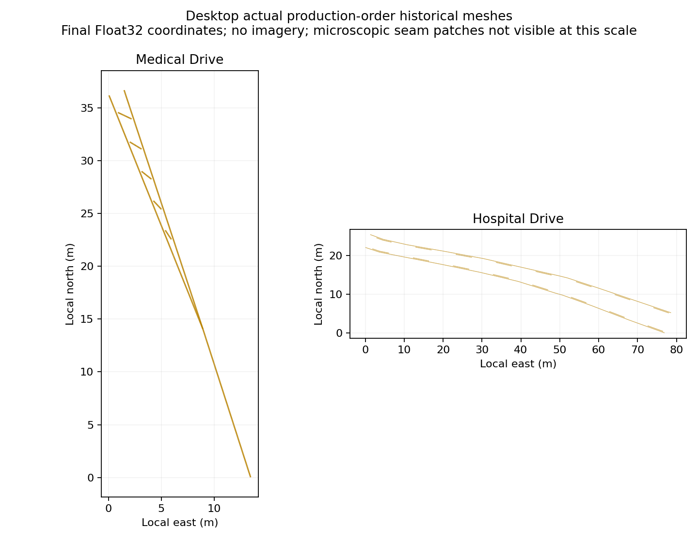
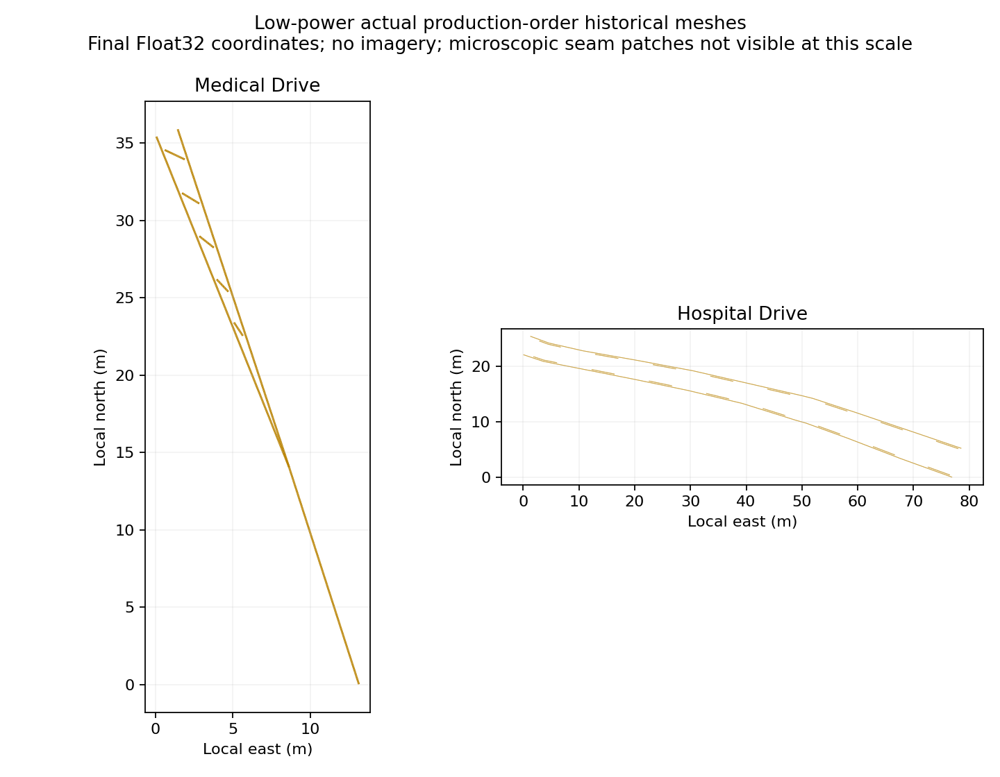

# Actual production-order pavement / paint regression

This author regression supersedes the reconciliation-order assumptions, counts,
contact JSON and plots in `VISIBLE-CONTACT-QA.md`. Those older artifacts appended
OSM ribbons after municipal reconciliation and are retained only as historical
experiments. Current verification is still false for historical real-world paint.

## Reproduce

From the repository root:

```sh
PRODUCTION_PAINT_REPORT=/tmp/production-low.json \
PRODUCTION_PAINT_GEOMETRY=/tmp/production-low-geometry.json \
node tools/test_production_paint_reconciliation.mjs
PRODUCTION_PAINT_REPORT=/tmp/production-desktop.json \
PRODUCTION_PAINT_GEOMETRY=/tmp/production-desktop-geometry.json \
node tools/test_production_paint_reconciliation.mjs --desktop
node tools/test_production_paint_reconciliation.mjs --full-network
node tools/test_production_paint_reconciliation.mjs --full-network --desktop
```

`PRODUCTION_PAINT_ROOT` optionally selects another candidate tree. The geometry
export contains final Float32 historical paint range coordinates and actual
municipal ROAD triangles for independent exact XY-union review. It is opt-in and
is not committed because it is large.

## What runs

The actual app `buildOfficialRoadSurfaces` orchestration runs with OSM ribbon and
foundation buffers already present. It executes Station and then Hospital
reconciliation. Actual batch namespace helpers, 3,600 m tiles and manifest-derived
world bounds are used. Road elevation/bridge processing and source surface indexes
precede municipal construction. Source rings and historical profiles are unchanged.

The default bounded correctness mode selects 308 complete municipal features
intersecting the two historical and two compound-arrow sites plus Station. Both
reconciliation passes are compared byte-for-byte with metadata-free control
transforms. The original mutable source range objects must survive and match the
final GPU geometry revision. Deliberately stale ranges yield positive unclassified
occluder coverage and actual rejected support samples, never guessed road identity.

All final target triangles are checked at corners, edge midpoints and centroids
against an independent raw triangle oracle including municipal surfaces, OSM road
ribbons and foundations. Faces must be upward and nondegenerate in Float32, have
municipal support, be unburied, and stay within 2.2 mm of the intended 8 mm lift.
Fixed-fixture historical retention is Medical three solid pieces and five hatches,
Hospital two solids and sixteen dashes. Source profiles and final road mesh bytes
must remain unchanged while generating paint.

## Cost scope

Full-network mode includes all 6,587 packaged road, parking and bridge features,
all source OSM road ribbons, actual municipal subdivision and both reconciliation
passes. It skips duplicate control transforms, which bounded mode already checks.
Reports separate index construction (included in historical timing), historical
plus generic-stub marking time, mapped-arrow time, final geometry bytes and paint
triangle counts. Node timings are observational, not browser frame-rate measures.

Water recess, buildings, curbs, bridge accessories, generic lane-paint output and
other streetscape layers are excluded. Generic `drapePaintStrip` returns no geometry.
No benchmark here is a complete browser load-time measurement. The bounded mode's
mapped count is not a full-network appearance total.

## Foundation finding

The preliminary Medical foundation occluder came from Medical way 250810393's own
`roadEdge` foundation. With actual final reconciliation order, that face is removed
at the reported point. The target raw-face checks require zero remaining foundation
burial; no foundation-based eligibility expansion is used.

## Final coordinate plots

These newly generated plots show actual emitted production-order Float32 paint,
with independently local east/north origins. They are geometry QA, not imagery or
current field verification. Their scale does not resolve microscopic contact gaps.




Recreate either with:

```sh
MPLCONFIGDIR=/tmp/mpl-paint python tools/plot_production_historical_paint.py \
  /tmp/production-desktop-geometry.json /tmp/production-desktop.png
```

## Recorded results

Candidate `b497947a8d41332351a94dc7ea45ad493310d612`; details in
`production-order-results.json`. Both final full-network runs executed every
committed assertion. Bounded byte-identical controls passed in both profiles.
The earlier bounded low-power run predates the added winding/lift and causal
staleness assertions; the final full-network low-power run includes them.

| Actual full-network metric | Low-power | Desktop |
|---|---:|---:|
| Municipal build, including both passes (s) | 18.67 | 22.12 |
| Station pass (s) | 13.45 | 14.97 |
| Hospital pass (s) | 1.93 | 2.27 |
| Shared index (ms) | 61.11 | 71.29 |
| Historical + generic stub (ms) | 1,030.32 | 1,258.62 |
| Mapped arrows (ms) | 1,244.45 | 1,450.79 |
| Mapped candidates | 185.00 | 185.00 |
| Mapped emitted | 173.00 | 173.00 |
| Road position bytes | 29,439,000.00 | 38,840,616.00 |

Both modes retain Medical 3 solid pieces + 5 hatches and Hospital 2 solids +
16 dashes, plus both mapped compound pairs. No target probes are buried or
unsupported; no paint faces are downward or degenerate. Ten same-XY fresh support
points become rejected when the range revisions are deliberately stale in each
mode. Medical and Hospital now have **zero local omitted contact patches** in both
modes; old nonzero gap metrics and their magnified plots are superseded. Desktop
Medical has only 0.000008967 m² Float32 subdivision area residual, separately
reported from omission. Foundation burial is zero.

Full-network mapped geometry is 54,046 / 55,146 triangles (low-power / desktop),
1,945,656 / 1,985,256 position bytes. Historical geometry is 5,954 / 6,000 triangles,
214,344 / 216,000 position bytes. Timings are single shared-host observations;
they should not be compared as controlled performance deltas to prior fixtures.
