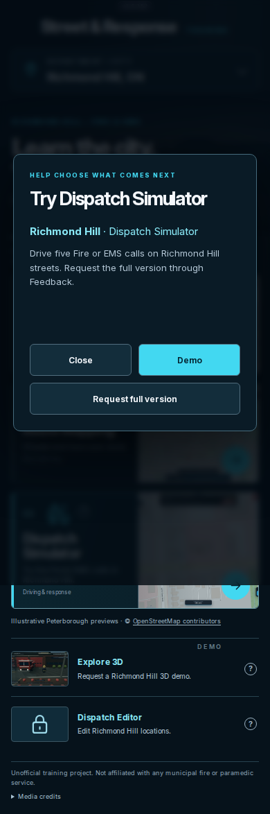
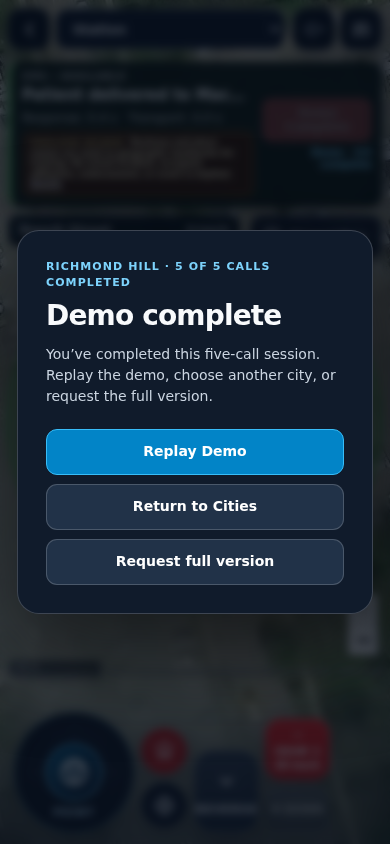
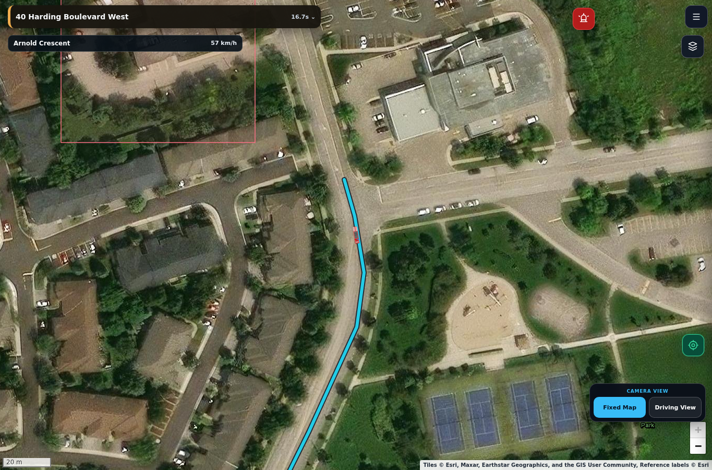

# Richmond Hill demo evidence

Build 1.6.153 integrates the separately published 3D cleanup. Original browser captures and reports below are from 1.6.152; follow-up launcher, routing and cache checks validate the integrated 1.6.153 build. The production demo behavior is unchanged between those checks.

## Reproduce

```sh
node --test tests/*.test.cjs tests/*.test.mjs

# Playwright must be available to Node; the harness hosts its own local server.
PTBO_CHROMIUM_EXECUTABLE=/path/to/headless_shell \
PTBO_QA_OUTPUT=/absolute/path/to/qa-output \
PTBO_QA_LIVE_TILES=1 \
node tests/richmond-hill-demo-browser.cjs
```

`PTBO_QA_CASES` accepts comma-separated case names. Without live tiles, the two map-render cases are skipped. Each case uses a fresh browser context. The compatible official Chromium 141 headless shell used here is available from the [Playwright CDN](https://playwright.download.prss.microsoft.com/dbazure/download/playwright/builds/chromium/1194/chromium-headless-shell-linux.zip).

For proxied live tiles, the harness reads the inherited HTTPS/HTTP proxy and excludes localhost. It never logs credentials. Normal TLS validation remains enabled. This environment required importing the existing `NODE_EXTRA_CA_CERTS` certificate into Chromium's NSS database with `certutil -A -d sql:/root/.pki/nssdb -n 'Codex configured runtime CA' -t 'C,,' -i "$NODE_EXTRA_CA_CERTS"`. Use the configured environment CA, without certificate-error suppression flags.

## Reports

- `node-tests-1.6.153.log`: final full Node suite after integration.
- `summary.json`: 11/11 unique browser cases, route counts and driving measurements from the original validation.
- `report.json`: original nine launcher, lifecycle, base, isolation and map cases.
- `native-followup-report.json`: actual street drive and native graph checks after the routing fix.
- `native-cache-report.json`, `native-route-runtime.json`: actual inner route-core script uses the canonical cache token.
- `native-routes.json`: native route-leg results.
- `native-street-trace.json`: route, displayed polyline and keyboard-control observations.
- `integration-1.6.153/`: focused post-rebase launcher, native routing and cache results.

Only the selected PNG captures below are committed. All three were visually inspected. JSON reports may mention other original captures that are not included in this compact evidence set.

### Mobile popup



### Mobile EMS completion



### Native street driving



The longer native trip used keyboard inputs alone and completed normally: 549 m planned route, 426.6 m observed on named streets outside the yard, completion 1/5, collision counter 32→32. The earlier short Station 8-4 test covered the modeled yard only. Other lifecycle scene/hospital arrivals use disclosed GPS fixtures and real timers. These results do not claim every selected route was fully driven.

The nine original cases were followed by isolated native street/routing/cache checks after fixing the route source. Post-rebase checks target the launcher, route graph and cache token. No actual Feedback messages, telemetry writes or other external mutations were performed; explicit request submission uses an in-memory adapter.
